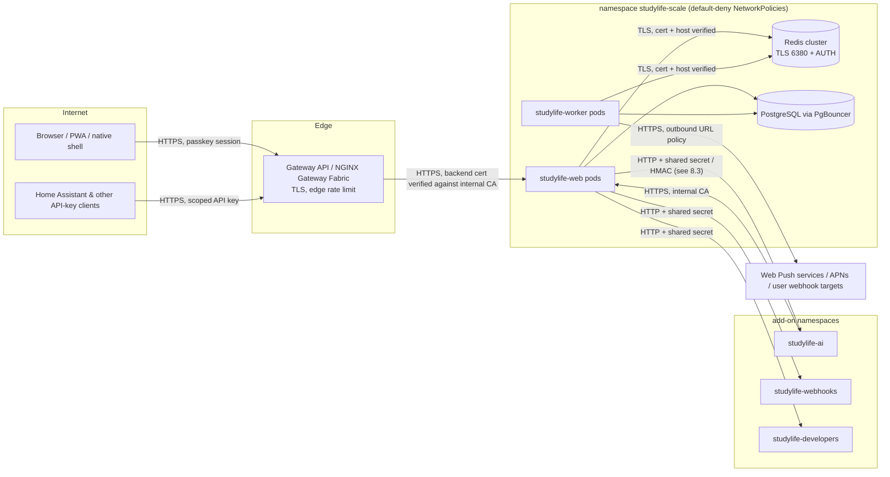

# Security Assurance Case

This document argues why StudyLife's security requirements are met. It covers the threat model,
the trust boundaries, how the secure-design principles are applied, how common implementation
weaknesses are countered, and which risks are knowingly accepted. It pulls the security-relevant
parts of [`ARCHITECTURE.md`](ARCHITECTURE.md#security), [`SCALING.md`](SCALING.md) and the
Kubernetes manifests into one argument and links to them for detail.

Last full review: **2026-11-03** (maintainer, see [Review record](#review-record)).

## 1. Claim

> A StudyLife installation deployed as documented keeps each user's study data confidential and
> intact against other users, against unauthenticated network attackers, and against
> integrations acting outside the permissions the user granted them. It also fails safe
> (rejects) when a credential, certificate or input is invalid.

What it does **not** claim: protection against an attacker who already controls the host,
a cluster node, the database or a pod inside the namespace; protection of data on a user's own
unlocked device; availability under a determined denial-of-service attack beyond rate limiting.

## 2. Assets

| Asset | Where it lives | Why it matters |
|---|---|---|
| Study data (sessions, notes, course goals, settings, timer state) | PostgreSQL (k8s) / SQLite (single container) | The user's personal data |
| Credentials: passkey public keys, session tokens, per-slot API keys, calendar/share tokens, recovery codes | Database, stored as SHA-256 hashes (except public keys) | Account takeover |
| Server secrets: DataProtection key ring, VAPID key, AI proxy signing secret, add-on shared secrets, APNs key, Redis/DB passwords | Kubernetes Secrets / SealedSecrets, mounted files; key ring encrypted at rest in Redis with a certificate | Forging tokens, impersonating the server |
| Backups | Downloaded by the owner; optional AES-256-GCM encryption | Contain the whole database |
| Release artifacts | `ghcr.io`, GitHub Releases | Supply-chain compromise of every installation |

## 3. Actors and threat sources

- **Anonymous internet user**: reaches the gateway, the open auth endpoints, the share link and
  the ICS feed.
- **Authenticated user**: has a valid session. Must not reach other users' data, or owner-only
  functions such as raw backup/restore.
- **Integration with an API key** (Home Assistant, MCP, capture extension, registered OAuth
  clients): must stay within its slot's scope.
- **Compromised add-on or sibling pod** inside the cluster: limited by NetworkPolicies and
  authenticated calls. It is partly out of scope (see the residual risks).
- **Supply-chain attacker**: tampered dependency, action or image.

## 4. Trust boundaries

| # | Boundary | Controls at the boundary |
|---|---|---|
| TB1 | Internet → gateway | TLS with HSTS. Edge rate limit. The only public entry point. |
| TB2 | Gateway → web pod | HTTPS. The gateway verifies the pod certificate against the internal CA (`k8s/07d-httproutes.yaml`). |
| TB3 | Request → application | `StudyLifeAuthenticationHandler`, with fallback policy `ApiAccess` on every endpoint. Per-slot scopes. Per-IP and global rate limits. Request size limits. Model validation. |
| TB4 | User A ↔ user B | EF Core global query filters on `AuthUserId`. Per-user cache keys. Owner-only checks for raw backup/restore. |
| TB5 | App → Redis / PostgreSQL | Redis over TLS with certificate and host-name validation (`RedisTlsConfiguration`), plus ACL user and password. PostgreSQL over the pooler, with credentials from Secrets. NetworkPolicies allow only web/worker. |
| TB6 | App ↔ add-ons | Shared secrets and HMAC-signed short-lived proxy tokens. Add-on → app calls use scoped keys over HTTPS. NetworkPolicies restrict the pairs. |
| TB7 | Worker → external URLs | `OutboundUrlPolicy`: only absolute https, and no private, loopback, link-local or cluster-internal targets. |
| TB8 | Source → release | Required checks, CodeQL, locked restore, SHA-pinned actions, Trivy gate. Keyless-signed images and zip with provenance. |

## 5. Threat model (STRIDE)

| Threat | Example | Countermeasure | Evidence |
|---|---|---|---|
| **S**poofing a user | Stolen password, phishing | No passwords at all. Passkeys (WebAuthn, origin-bound). New devices need approval from an existing device. | `docs/ARCHITECTURE.md` Phase 2. `AuthController.*` tests |
| Spoofing the first owner | Racing the operator to the first registration | One-time setup secret printed to the server log, compared in constant time | `SetupSecretService`, audit section in ARCHITECTURE |
| Spoofing a server (Redis, K8s API) | Rogue TLS endpoint in the cluster | Certificate chain to the internal CA, plus host-name check | `PrivateCaCertificateValidator` + loopback handshake tests |
| **T**ampering with data of another user | IDOR on `/api/sessions/{id}` | Global query filters. Every query is scoped to the authenticated user. | Two-user regression tests (ARCHITECTURE, "Security review after Phase 3") |
| Tampering with releases | Malicious image | Sigstore keyless signatures, SBOM, SLSA provenance, Trivy gate | `SECURITY.md#verifying-releases`, `ci-cd.yml` |
| **R**epudiation | — | Single-tenant-per-account data. Structured request logs and traces (OTLP). There is no audit-log product requirement. | `docs/ARCHITECTURE.md#telemetry` |
| **I**nformation disclosure across users | Shared cache entries | Cache keys include the user id. ETag is a body hash. | Audit fix in ARCHITECTURE |
| Disclosure of credentials | DB dump leaks tokens | Tokens and keys are stored as SHA-256 of 32-byte CSPRNG values. Plaintext is shown once. | `AuthSessionService`, API key flow |
| Disclosure via enumeration | `login/begin` listing credential IDs | Empty `AllowedCredentials` (discoverable credentials) | Audit fix in ARCHITECTURE |
| **D**enial of service | Huge uploads, unbounded generators | `RequestSizeLimit` / `RejectOversizedBody`, bounds in services, per-IP and global rate limiters, per-user concurrency cap on CPU-heavy endpoints | ARCHITECTURE "Request bounds" |
| **E**levation of privilege | Narrow add-on key used for full API | `ApiKeyScopes` map, `ApiKeyScopeAuthorizationHandler` (403) with unconditional enforcement. Dynamic clients get `PubliclyGrantable` scopes only, with PKCE. | ARCHITECTURE "Per-slot endpoint scoping" |
| Elevation via open redirect in consent | Key theft through `redirect_uri` | Per-audience allowlist (`ConsentRedirectPolicy`) | ARCHITECTURE "Consent redirect allow-list" |
| SSRF via push/webhook URLs | Worker as a proxy into the cluster | `OutboundUrlPolicy` | ARCHITECTURE "Request bounds and outbound-URL policy" |

## 6. Secure design principles

How the classic Saltzer & Schroeder principles show up in the code:

- **Economy of mechanism.** There is one authentication handler with one credential resolution
  order, and one scope map (`Auth/ApiKeyScopes.cs`). Crypto comes from the platform
  (`System.Security.Cryptography`, Fido2NetLib), with no self-made primitives.
- **Fail-safe defaults.** `ApiAccess` is the fallback policy, so a new endpoint is authenticated
  unless it opts out. Registration defaults to `invite`. Telemetry is off by default. Demo mode
  needs an explicit second confirmation variable. TLS peers are rejected unless the certificate
  validates, and there is no switch to skip validation.
- **Complete mediation.** Every `/api` request goes through ASP.NET Core authentication and
  authorization, and per-user filtering happens in the data layer (query filters), not in each
  controller.
- **Open design.** The whole system is public (AGPL), including the threat model, and security
  does not depend on secrecy of the code.
- **Separation of privilege.** Owner-only actions need a real session and owner status, and an
  API key is never enough. A new device needs approval from an existing one.
- **Least privilege.** Each integration's key is scoped to the endpoints it really calls. Pods
  run as non-root with a read-only root filesystem, all capabilities dropped and seccomp
  `RuntimeDefault`, and the ServiceAccount token is mounted only where the Kubernetes API is
  needed (worker, read-only `scale` RBAC). NetworkPolicies are default-deny.
- **Least common mechanism.** Each secret space is separate (session tokens, API keys per slot,
  calendar tokens, share tokens), so one kind of token can never be used as another.
- **Psychological acceptability.** Passkeys instead of passwords. Pairing with Home Assistant is
  a single copy-and-paste. Consent pages show the redirect target's host.

## 7. Common implementation weaknesses (OWASP Top 10 2021)

| Category | Countermeasure |
|---|---|
| A01 Broken access control | Fallback policy, query filters, scope map, owner checks, two-user regression tests |
| A02 Cryptographic failures | Only published algorithms (AES-256-GCM, PBKDF2-SHA256 with 210 000 iterations, HMAC-SHA256, SHA-256, WebAuthn via Fido2NetLib). CSPRNG for every secret. TLS everywhere outside the cluster, and validated TLS to Redis and the K8s API. See 8.3 for the remaining plain-HTTP hops. |
| A03 Injection | EF Core with parameterised queries only. Razor/Blazor output encoding. Strict CSP. No shell execution with user input. |
| A04 Insecure design | This document. Bounds on generators (exam planner, history ranges). Single-use assertions. |
| A05 Security misconfiguration | Security headers set by the app (CSP, HSTS, XFO, Permissions-Policy, nosniff). Hardened pod security contexts. `kubeconform` and `kustomize` checks in CI. |
| A06 Vulnerable components | Dependabot and Renovate, NuGet severity gate, dependency review on every PR, Trivy gate on the image, Socket |
| A07 Identification and authentication failures | Passkeys, sliding sessions capped at 180 days, revocation on device removal and recovery, throttled recovery login |
| A08 Software and data integrity failures | Locked NuGet restore, SHA-pinned actions, signed releases with provenance, signed commits required on `main` |
| A09 Logging and monitoring failures | Structured logs, Prometheus metrics, OTLP traces, Grafana alerting (production) |
| A10 SSRF | `OutboundUrlPolicy` for push and webhooks, and fixed in-cluster URLs for add-ons (config, not user input) |

Static analysis (CodeQL on every push and PR, .NET analyzers with warnings as errors) checks
for these classes of bugs continuously.

## 8. Specific arguments

### 8.1 Input validation

Every input from a potentially untrusted source is checked before use, and invalid input is
rejected rather than repaired:

1. **Transport and size.** Kestrel's default limits apply, plus `[RequestSizeLimit]` /
   `[RequestFormLimits]` / `[RejectOversizedBody]` on every upload endpoint (backup import,
   dictation, ICS import, telemetry). The 413 response comes before model binding.
2. **Shape and type.** All controllers are `[ApiController]`. The JSON binds to typed DTOs in
   `StudyLife.Shared/Dtos.cs`, and anything that does not parse into the declared types is a
   400. DTO fields carry DataAnnotations (`[MaxLength]`, `[Range]`, `[Required]`, about 100
   attributes), and an invalid model state is answered with 400 automatically.
3. **Semantics.** Controllers and services check what annotations cannot express: time ranges
   (`ExamPlanService`, history `days` 1–3650), exam-plan session length 5–480 minutes and total hours up to 1000, and the
   explicit checks in the controllers and in the services behind them, which answer with a 400
   through `ServiceResult`. These are allowlist checks: a value must be inside a known
   range or set. Anything else is rejected.
4. **URLs and redirects.** These are allowlisted by dedicated policies: `OutboundUrlPolicy`
   (push/webhook targets) and `ConsentRedirectPolicy` (per-audience redirect URIs, plus exact
   matches for registered clients).
5. **Credentials.** Credentials are compared by hash lookup or `CryptographicOperations.FixedTimeEquals`, never parsed
   beyond format checks.
6. **Files.** Restores are validated before they replace anything (`DatabaseRestoreService.Validate`
   on a working copy), and the ICS parser has a linear-time unfolding step with size limits.

The house rule for new code: a new endpoint or DTO field gets bounds in the DTO or an explicit
check in its controller or service, and a test for the rejection.

### 8.2 Cryptography and agility

The algorithms are listed under A02 above. Algorithm agility is limited but real: the backup
format has a version magic (`SLBKENC1`), so a new KDF or cipher means a new version tag that
old readers refuse. DataProtection (ASP.NET Core) carries its own algorithm descriptors. TLS
versions and cipher suites come from the OS and OpenSSL defaults, which means TLS 1.2 or later
with no downgrade configured anywhere. Credentials (keys, secrets, certificates) are never
compiled in: they come from configuration and files and can be rotated without a rebuild.

Where each algorithm is fixed and what replacing it would take:

| Use | Algorithm | How it can be replaced |
|---|---|---|
| Passkey sign-in (WebAuthn) | Negotiated per credential (COSE algorithm list of Fido2NetLib, e.g. ES256, RS256, EdDSA) | Already agile: the authenticator picks from the server's list, and the stored credential records its algorithm. |
| TLS (Kestrel, Redis, PostgreSQL, Kubernetes API, add-ons) | Negotiated by the OS TLS stack, TLS 1.2+ | Already agile: protocol versions and cipher suites follow the OS/OpenSSL configuration. |
| DataProtection (antiforgery, auth cookies, key ring at rest) | ASP.NET Core defaults (AES-256-CBC + HMAC-SHA256), key ring encrypted with an X.509 certificate | Already agile: every payload carries its key id, and the key descriptor records the algorithms, so a changed configuration applies to new keys while old payloads stay readable. |
| Encrypted backups | PBKDF2-SHA256 (210 000 iterations) + AES-256-GCM | Versioned format: the magic `SLBKENC1` names the version. A new KDF or cipher gets `SLBKENC2` and the reader dispatches on the magic. Old readers refuse unknown versions instead of misreading them. |
| AI proxy tokens | HMAC-SHA256 | Keys are agile: `kid:secret` lists, the first entry signs, and all entries verify, so keys roll without downtime. The algorithm is implied by the token format (the legacy 3-part and the current 4-part format are already told apart by their segment count), so a new MAC means a new format, accepted by studylife-ai next to the old one for the token lifetime (5 minutes). |
| Session tokens, API keys, recovery codes | Random 32 bytes, stored as SHA-256 | A different hash means new tokens. Sessions expire on their own, and API keys and recovery codes would have to be re-issued. That is acceptable because SHA-256 over 256-bit random values has no realistic attack. |
| Release signatures | Sigstore (ECDSA P-256, Fulcio/Rekor), SSH-signed tags (Ed25519) | Defined by the tools: cosign and git follow their upstream defaults. |

### 8.3 In-cluster plain-HTTP calls

Three hops still use plain HTTP inside the cluster: web → studylife-ai (`:8000` public proxy
paths, `:8001` `/internal`), web → studylife-webhooks (`:8000`) and web → studylife-developers
(`:8080`) (`k8s/01-config-and-secret.yaml`). Each request carries a shared secret or a
short-lived HMAC-signed token.

**Assessment.** An attacker who can sniff pod-to-pod traffic (a compromised node, or a
compromised pod on a CNI without encryption) can read those secrets and replay them within
their lifetime. NetworkPolicies already limit who can *connect*, but they do not provide
confidentiality. The traffic stays inside the cluster network.

**Plan** (on the [roadmap](../ROADMAP.md)): each add-on serves TLS with a certificate from
`studylife-internal-ca-issuer`. StudyLife's HTTP clients for the three add-ons then get an optional
`TlsCaCertificatePath` validated through the same `PrivateCaCertificateValidator`, and the base
URLs switch to `https://`. This needs coordinated releases of the add-on repositories, so it is
deliberately not part of a single change here. A cluster-wide alternative is a CNI with
transparent encryption (WireGuard) or a service mesh with mTLS.

### 8.4 Supply chain

`main` only changes through pull requests that pass the required checks: build, four test
projects, lint, i18n, security gate, OpenAPI contract, EF migrations, k8s and compose checks, and
CodeQL. Commits must be signed. Dependencies are pinned (NuGet lock files, action SHAs, image
digests) and updated by bots through the same gate. Releases are produced only by CI and signed
keyless. Verification steps are in [SECURITY.md](../SECURITY.md#verifying-releases).

### 8.5 Dynamic analysis (OWASP ZAP)

[`.github/workflows/dast.yml`](../.github/workflows/dast.yml) runs a ZAP baseline scan and an
OpenAPI-driven active API scan against the released container every week. The first scan
(2026-11-03, v3.23.44, ZAP 2.16.1) found no High alerts. Triage of the Medium and Low alerts:

| Alert (risk) | Outcome |
|---|---|
| CSP: `style-src unsafe-inline` (Medium) | **Narrowed.** `style-src` and `style-src-elem` are now `'self'` only, so `<style>` elements and inline stylesheets are blocked. Only inline style *attributes* remain allowed, through `style-src-attr 'unsafe-inline'`, because the Razor components bind runtime values into them (about 250 places: progress widths, course colours, chart bars) and Blazor applies attributes with `setAttribute()`, which CSP treats like markup. Nonces and hashes cannot cover attribute values that change at runtime. The static shell (`index.html`) no longer has any style attributes. See residual risks (9). |
| Insufficient Site Isolation Against Spectre (Low, both scans) | **Fixed.** Every response carries `Cross-Origin-Resource-Policy: same-origin`, `Cross-Origin-Opener-Policy: same-origin` and `Cross-Origin-Embedder-Policy: require-corp`. |
| Unexpected Content-Type (Low, API scan) | **Fixed for the machine-only namespaces:** unknown `/.well-known/*` and `/healthz*` paths now return 404 instead of the SPA shell (unknown `/api/*` paths already did). **Accepted for the rest:** `/` and other unknown paths return `index.html` as `text/html` on purpose, because they are client-side routes of the single-page app. ZAP's API scan expects JSON or XML from every URL under the API's base, which does not fit an app that serves its UI and API from one origin. |
| ZAP is Out of Date (Low, both scans) | **Fixed.** The scanner image was 2.16.1; the workflow now uses ZAP 2.17.0. This alert is about the scanner, not the application. |
| Informational alerts | Reviewed, no action: the "suspicious comments" are keyword matches ("select", "later", "from") in the Blazor runtime and in our own boot-script comments, with nothing sensitive in them; "Modern Web Application" is expected for a SPA; the cacheability notes match the intended `Cache-Control` headers (`no-cache` revalidation for the shell and static files, `no-store` for the API). |

## 9. Residual risks (accepted)

| Risk | Why accepted | Mitigation |
|---|---|---|
| Plain HTTP for the three add-on hops (8.3) | Needs changes in other repositories | NetworkPolicies, short-lived HMAC tokens, planned TLS |
| Redis cluster bus (gossip) in plaintext | `tls-cluster yes` broke the pod-IP-based cluster during a rolling update ([SCALING.md](SCALING.md)) | Bus port reachable only between Redis pods (NetworkPolicy). No user payload on the bus beyond replication. |
| Redis password visible in the Redis process command line | Redis reads it as CLI flags from a Secret | Visible only to someone who can exec into the Redis pod, which is already past the boundary |
| DNS rebinding for push/webhook URLs | Host names are not resolved on the request path | Literal private IPs and internal suffixes are rejected |
| `X-Forwarded-For` trust on a flat pod network | No CIDR can single out the gateway | IP-independent global bucket for recovery login, configurable `KnownNetworks` |
| Inline style attributes allowed (`style-src-attr 'unsafe-inline'`, 8.5) | Blazor binds dynamic values into `style=""` attributes; moving about 250 of them to classes or CSSOM interop is a large UI refactor | Scripts stay strict (`script-src 'self' 'wasm-unsafe-eval'`, no inline script). `<style>` elements are blocked, so injected markup cannot add selector-based CSS that reads attribute values. A style attribute can only restyle its own element, and `url()` loads are limited by `img-src`/`font-src` `'self'`. Razor output encoding prevents markup injection in the first place. |
| Single maintainer (bus factor 1) | No second person available | [GOVERNANCE.md](../GOVERNANCE.md) continuity section, fully public build |

## 10. Review record

| Date | Scope | By | Outcome |
|---|---|---|---|
| 2026-08 / 2026-09 | Multi-user overhaul (phases 1–3), audit rounds A1–A6, S1–S12, O1–O6 | Maintainer (internal) | Findings and fixes documented in [ARCHITECTURE.md](ARCHITECTURE.md#security), each with regression tests |
| 2026-11-03 | This assurance case: requirements, trust boundaries, TLS validation of internal peers | Maintainer (internal) | TLS validation for Redis and the K8s API fixed. In-cluster plain-HTTP hops assessed and planned (8.3). Residual risks listed (9). |

No external security review has taken place so far. The next internal review is due when a
trust boundary changes, and at the latest after twelve months.
